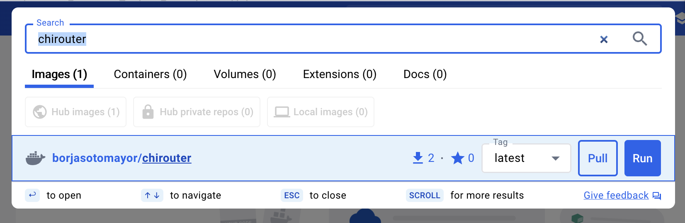
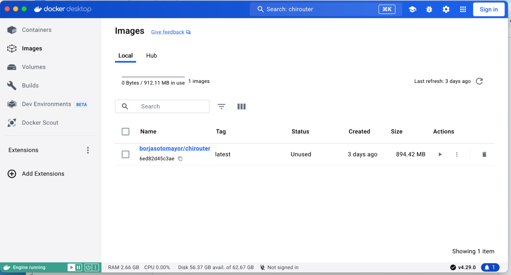
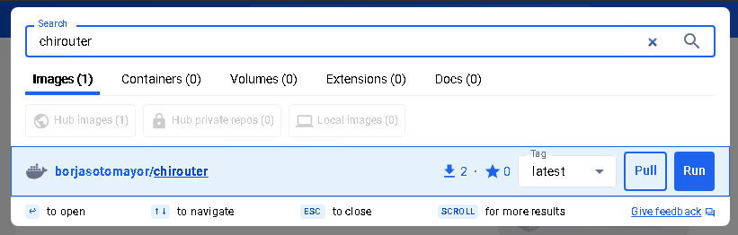
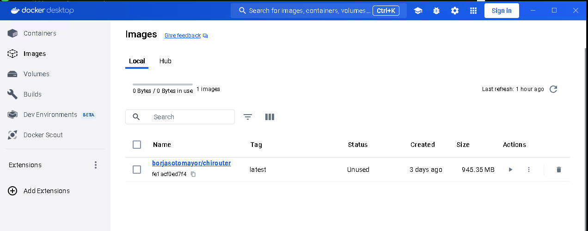

.. _chirouter-installing:

Installing, Building, and Running chirouter
===========================================

The source code for chirouter can be found in the following GitHub repository:

https://github.com/uchicago-cs/chirouter

To work on the assignments, all you need to do is clone this repository. However,
please note that your instructor may give you more specific instructions on how
to get the chirouter code.

Building chirouter
------------------

To build chirouter, you need a C compiler, ``make``, and `CMake <https://cmake.org/>`__ (version 3.21 or higher).
These may not be installed by default (in particular, a new Ubuntu installation on WSL2
does not include them). On Ubuntu (including Ubuntu on WSL2), you can install them
by running the following::

    sudo apt update
    sudo apt install build-essential cmake

The first time you download the chirouter code to your machine, you must run the
following from the root of the chirouter code tree::

    cmake -B build/

This will generate a number of files necessary to build chirouter.

Once you have done this, simply run ``make`` inside the ``build`` directory
to build chirouter. This will generate the ``chirouter`` executable.

This executable accepts the following parameters:

* ``-p PORT``: [Optional] Port that chirouter will listen on (the simulated network,
  described below, will connect to this port to send the router its configuration,
  and the Ethernet frames that arrive at the router). Defaults to 23320.
* ``-c FILE``: [Optional] When specified, produces a capture file (in PCAPNG format) with all
  the Ethernet frames sent/received by the routers. This file can be opened in Wireshark for analysis.
* ``-v``, ``-vv``, or ``-vvv``: To control the level of logging. This is described in
  more detail in :ref:`chirouter-implementing`
* ``-q``: Do not print any log messages.

Installing the chirouter Docker container
-----------------------------------------------------

chirouter depends on the `Mininet <http://mininet.org/>`__ network emulator to simulate the conditions of a real network.
While it is technically possible to install Mininet by itself, it is much easier to run a Docker container
with all the necessary software. We provide such a container, and provide instructions below on how to install
it and run it. The container works on both Intel/AMD computers and ARM computers (including Macs with Apple
Silicon); Docker will automatically download the right version for your computer.

Please note that you will *not* run chirouter inside the container. Instead, you will run chirouter
on your computer and the simulated network inside the container, and the simulated network
will connect to chirouter.

Before performing these steps, make sure that you have built chirouter as described above.

MacOS / Linux
~~~~~~~~~~~~~

First of all, you will need to install Docker
Desktop on `Mac <https://docs.docker.com/desktop/install/mac-install/>`__
or `Linux <https://docs.docker.com/desktop/setup/install/linux/>`__ (on Linux,
you can also use `Docker Engine <https://docs.docker.com/engine/install/>`__
instead of Docker Desktop). You
may be prompted to “sign up” for a Docker account. You are welcome to do
so, but none of the steps below require a Docker account (you can just
click on “Continue without signing in” when prompted to sign up for an
account)

Once you’ve installed Docker Desktop, open it and, on the search bar,
type in “chirouter”:

Click the “Pull” button next to “borjasotomayor/chirouter”

Once the download is complete, you should see the image appear in the
“Images” section on Docker Desktop:

Alternatively, you can download the image by running the following in a terminal::

   docker pull borjasotomayor/chirouter

Next, open two terminal windows. On the first terminal window, go to the
``build`` directory of your repository, and run the following:

::

   ./chirouter -vv

You should see the following:

::

   [2026-11-03 18:42:51]   INFO Waiting for connection from Mininet...

On the second terminal, run the following from the root of your
repository:

::

   ./run-docker basic

You should see the following:

::

   *** Error setting resource limits. Mininet's performance may be affected.
   *** Creating network
   *** Adding hosts:
   client1 client2 server1 server2
   *** Adding switches:
   r1 s1001 s1002 s1003
   *** Adding links:
   (client1, s1003) (client2, s1003) (r1, s1001) (r1, s1002) (r1, s1003) (server1, s1001) (server2, s1002)
   *** Configuring hosts
   client1 client2 server1 server2
   *** Starting web server on host server1
   *** Starting web server on host server2
   *** Starting controller

   *** Starting 4 switches
   r1 s1001 s1002 s1003
   *** Connecting to chirouter at host.docker.internal:23320
   *** Starting CLI:
   mininet>

If you look at the first terminal, you should see the following output:

::

   [2026-11-03 18:42:52]   INFO Mininet connected from 172.17.0.2:48054
   [2026-11-03 18:42:52]   INFO Received 1 routers
   [2026-11-03 18:42:52]   INFO --------------------------------------------------------------------------------
   [2026-11-03 18:42:52]   INFO ROUTER r1
   [2026-11-03 18:42:52]   INFO
   [2026-11-03 18:42:52]   INFO eth1 12:A3:1B:8D:52:62 192.168.1.1
   [2026-11-03 18:42:52]   INFO eth2 A6:0B:0F:02:33:92 172.16.0.1
   [2026-11-03 18:42:52]   INFO eth3 7A:46:EC:85:E2:22 10.0.0.1
   [2026-11-03 18:42:52]   INFO
   [2026-11-03 18:42:52]   INFO Destination     Gateway         Mask            Iface
   [2026-11-03 18:42:52]   INFO 192.168.0.0     0.0.0.0         255.255.0.0     eth1
   [2026-11-03 18:42:52]   INFO 172.16.0.0      0.0.0.0         255.255.240.0   eth2
   [2026-11-03 18:42:52]   INFO 10.0.0.0        0.0.0.0         255.0.0.0       eth3
   [2026-11-03 18:42:52]   INFO --------------------------------------------------------------------------------

Note: The MAC addresses (and the address Mininet connects from) will be different,
but everything else should look as it does above.

To exit the Mininet prompt in the second terminal, press Control-D.

Next up, skip to the "Running chirouter" section below.

Windows
~~~~~~~

First of all, you will need to `install Docker
Desktop <https://docs.docker.com/desktop/install/windows-install/>`__. You can use
the default settings (including using WSL2, which you will also need to build and run
chirouter).

After Docker Desktop has finished installing (this may include
restarting your computer), open it. You may be prompted to “sign up” for
a Docker account. You are welcome to do so, but none of the steps below
require a Docker account (you can just click on “Continue without
signing in” when prompted to sign up for an account)

Next, type in “chirouter” on the Docker Desktop search bar:

Click the “Pull” button next to “borjasotomayor/chirouter”

Once the download is complete, you should see the image appear in the
“Images” section on Docker Desktop:

Alternatively, you can download the image by running the following in a WSL2 terminal::

   docker pull borjasotomayor/chirouter

Docker Desktop makes the ``docker`` command available in WSL2. If the ``docker``
command is not found, or you get an error like ``Cannot connect to the Docker daemon
at unix:///var/run/docker.sock``, open Docker Desktop's Settings, go to "Resources" and then
"WSL integration", and make sure integration is enabled for your Ubuntu distribution.
You will run all the commands below in WSL2, not in PowerShell or the Command Prompt.

Next, open two WSL2 terminals. On the first terminal, go to the ``build``
directory of your repository, and run the following:

::

   ./chirouter -vv

You should see the following:

::

   [2026-11-03 18:42:51]   INFO Waiting for connection from Mininet...

On the second terminal, run the following from the root of your
repository:

::

   ./run-docker basic

You should see the following output:

::

   *** Error setting resource limits. Mininet's performance may be affected.
   *** Creating network
   *** Adding hosts:
   client1 client2 server1 server2
   *** Adding switches:
   r1 s1001 s1002 s1003
   *** Adding links:
   (client1, s1003) (client2, s1003) (r1, s1001) (r1, s1002) (r1, s1003) (server1, s1001) (server2, s1002)
   *** Configuring hosts
   client1 client2 server1 server2
   *** Starting web server on host server1
   *** Starting web server on host server2
   *** Starting controller

   *** Starting 4 switches
   r1 s1001 s1002 s1003
   *** Connecting to chirouter at host.docker.internal:23320
   *** Starting CLI:
   mininet>

On the first terminal, you should see the following:

::

   [2026-11-03 18:42:52]   INFO Mininet connected from 172.17.0.2:48054
   [2026-11-03 18:42:52]   INFO Received 1 routers
   [2026-11-03 18:42:52]   INFO --------------------------------------------------------------------------------
   [2026-11-03 18:42:52]   INFO ROUTER r1
   [2026-11-03 18:42:52]   INFO
   [2026-11-03 18:42:52]   INFO eth1 12:A3:1B:8D:52:62 192.168.1.1
   [2026-11-03 18:42:52]   INFO eth2 A6:0B:0F:02:33:92 172.16.0.1
   [2026-11-03 18:42:52]   INFO eth3 7A:46:EC:85:E2:22 10.0.0.1
   [2026-11-03 18:42:52]   INFO
   [2026-11-03 18:42:52]   INFO Destination     Gateway         Mask            Iface
   [2026-11-03 18:42:52]   INFO 192.168.0.0     0.0.0.0         255.255.0.0     eth1
   [2026-11-03 18:42:52]   INFO 172.16.0.0      0.0.0.0         255.255.240.0   eth2
   [2026-11-03 18:42:52]   INFO 10.0.0.0        0.0.0.0         255.0.0.0       eth3
   [2026-11-03 18:42:52]   INFO --------------------------------------------------------------------------------

Note: The MAC addresses (and the address Mininet connects from) will be different,
but everything else should look as it does above. On Windows, Mininet will usually
connect from ``127.0.0.1``.

To exit the Mininet prompt in the second terminal, press Control-D.

Next up, skip to the "Running chirouter" section below.

Running chirouter
-----------------

Running chirouter involves running the ``chirouter`` executable in one terminal,
and Mininet (using the Docker container) in another terminal. To do this,
follow the same instructions described above when installing the Docker container.

The first parameter to the ``run-docker`` script specifies the network topology
we want to simulate::

    ./run-docker basic

(on Windows, remember to run this in a WSL2 terminal)

These topologies are described in more detail in the :ref:`chirouter-testing`
page but, for now, all we need to know is that the ``basic`` topology involves
a single router connecting multiple networks together, each containing some hosts.

The Mininet terminal (which will show a prompt like this: ``mininet>``)
will allow you to run network commands on a specific host of the topology. For example,
this::

   mininet> client1 ping -c 4 server1

Would run the ``ping`` command on ``client1`` (and would specifically
ping ``server1`` four times). While the network itself is being simulated
by Mininet, the commands that are being run are the exact same ones you
would run on a Linux system.

Please note that the above command won't yet work, because you have not
yet implemented the router. However, to verify that Mininet is running correctly,
you can run the following::

   mininet> client1 ping -c 4 client1
   PING 10.0.100.1 (10.0.100.1) 56(84) bytes of data.
   64 bytes from 10.0.100.1: icmp_seq=1 ttl=64 time=0.037 ms
   64 bytes from 10.0.100.1: icmp_seq=2 ttl=64 time=0.025 ms
   64 bytes from 10.0.100.1: icmp_seq=3 ttl=64 time=0.047 ms
   64 bytes from 10.0.100.1: icmp_seq=4 ttl=64 time=0.036 ms

   --- 10.0.100.1 ping statistics ---
   4 packets transmitted, 4 received, 0% packet loss, time 3062ms
   rtt min/avg/max/mdev = 0.025/0.036/0.047/0.007 ms

The above command just instructs ``client1`` to ping itself. Since your router isn't involved in delivering the
messages, this will run fine even if you haven't implemented the router yet. On the other hand, the following
command instructs ``client1`` to ping ``10.0.0.1`` (one of the router's interfaces). Since you have
not yet implemented your router, it will not reply to the pings (and ``client1`` will report that
the router is unreachable, since the router doesn't reply to its ARP requests either)::

   mininet> client1 ping -c 4 10.0.0.1
   PING 10.0.0.1 (10.0.0.1) 56(84) bytes of data.
   From 10.0.100.1 icmp_seq=1 Destination Host Unreachable
   From 10.0.100.1 icmp_seq=2 Destination Host Unreachable
   From 10.0.100.1 icmp_seq=3 Destination Host Unreachable

   --- 10.0.0.1 ping statistics ---
   4 packets transmitted, 0 received, +3 errors, 100% packet loss, time 3069ms

(Depending on timing, you may see four ``Destination Host Unreachable`` lines instead of three.)

However, if you look at the chirouter logs, you should see that it *is* receiving ARP requests from ``client1``::

    [2026-11-03 18:42:55]  DEBUG Received Ethernet frame on interface r1-eth3
    [2026-11-03 18:42:55]  DEBUG    ######################################################################
    [2026-11-03 18:42:55]  DEBUG <  Src: 5A:B8:C3:C7:A9:1D
    [2026-11-03 18:42:55]  DEBUG <  Dst: FF:FF:FF:FF:FF:FF
    [2026-11-03 18:42:55]  DEBUG <  Ethertype: 0806 (ARP)
    [2026-11-03 18:42:55]  DEBUG <  Payload (28 bytes):
    [2026-11-03 18:42:55]  DEBUG   0000  00 01 08 00 06 04 00 01 5a b8 c3 c7 a9 1d 0a 00  ........Z.......
    [2026-11-03 18:42:55]  DEBUG   0010  64 01 00 00 00 00 00 00 0a 00 00 01              d...........
    [2026-11-03 18:42:55]  DEBUG    ######################################################################

As you develop your router, please note that it is important that you start chirouter and Mininet in
the same order: chirouter first, followed by Mininet.

You should always exit Mininet by pressing Control-D at the ``mininet>`` prompt.
If you close the terminal instead, the container may keep running in the background.
You can see the running containers with ``docker ps`` (or in the "Containers" section
of Docker Desktop), and stop a container with ``docker rm -f CONTAINER``, where
``CONTAINER`` is the container ID or name shown by ``docker ps``.

Running without a topology
~~~~~~~~~~~~~~~~~~~~~~~~~~

If you run ``run-docker`` without any parameters, you will instead get a
root shell in the container::

   $ ./run-docker
   root@e37390d6efd7:/chirouter#

You will need to do this to run the automated tests, which are described
later in this documentation.

Inside this root shell, you can also run a ``run-mininet`` command directly
to start Mininet::

       $ ./run-docker
       root@e37390d6efd7:/chirouter# ./run-mininet topologies/basic.json
       *** Error setting resource limits. Mininet's performance may be affected.
       *** Creating network
       *** Adding hosts:
       client1 client2 server1 server2
       … etc …

**CAREFUL**: When you exit this root shell, any work you did inside the container
will be lost. You should only use the container to run Mininet or the automated tests;
you should not be creating and saving any files inside the container.

Finally, chirouter listens on port 23320 for connections from Mininet
(and Mininet will, by default, use that port). Since you will be running
on your own computer, this should not cause any conflicts but, if you do
need to use a different port, run chirouter like this::

   ./chirouter -p PORT

(where ``PORT`` is the alternate port you want to use)

And, from the container’s root shell, run this::

   ./run-mininet topologies/basic.json --chirouter host.docker.internal:PORT
